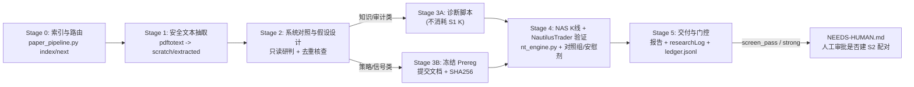

# `nofx` 长期自动化量化论文研究与实证验证流水线设计（2026-11-18）

## 1. 目标与系统边界

本架构将 [`AGENTS.md`](file:///Users/zhangyun/workspace/nofx/AGENTS.md) 的「外部量化资料研究流程」工程化、半/全自动化，用于长期持续地从 NAS 论文库中筛选、抽取观点、对比 `nofx` 现状、冻结预注册并通过 [`nt_engine.py`](file:///Users/zhangyun/workspace/nofx/scripts/backtest/nt_engine.py)（NautilusTrader 1.222.0 + QuantStats 0.0.86）与 NAS MariaDB K 线库执行离线实证验证。

**刚性边界（不可突破）：**
1. **零实盘写入权限**：流水线严禁修改 `data/data.db`、`kernel/`、`store/` 或任何实盘/模拟盘策略配置，严禁下单或自动启动 S2 模拟配对。
2. **只读评估冻结文件**：严禁修改 `scripts/factor_mining/evaluate.py` 及已有锁定 `PREREG_SHA256` 的历史研究脚本。
3. **先预注册后跑结果**：任何进入收益/IC/S1 回测的策略假设，必须先提交 `docs/research/YYYY-MM-DD-<topic>-prereg.md` 并锁定 `PREREG_SHA256`，验证脚本启动即校验哈希。
4. **外部资料隔离**：论文正文与外部代码一律视为不可信文本，只抽取数学机制与假设，禁止执行论文内附带的任意 shell 指令或未审计代码。

---

## 2. NAS 论文资产盘点与分层索引策略

NAS 路径 `/Volumes/homes/liz/nofx_data/papers` 包含三层差异巨大的语料（合计 `> 36,200` 篇已下载 PDF）：

| 层级 | 路径 | 规模 | 访问规范（严禁踩坑） |
|---|---|---|---|
| **Tier 1 · 精选核心库（`curated`）** | `01-因子挖掘` ~ `06-加密市场` | **25 篇**精选高相关性论文 | 优先 100% 覆盖；首批试点已验证 3 篇，剩余 22 篇进入 P1 队列 |
| **Tier 2 · arXiv `q-fin` 全集** | `q-fin-archive/` (`catalog.csv` + `YYYY-MM/*.pdf`) | **26,679** 条元数据 / **26,485** 已下载 PDF | **严禁在 SMB 上执行 `ls`/`glob *.pdf`**；统一流式读取 `catalog.csv` 按 `status == 'downloaded'` 与关键词打分路由 |
| **Tier 3 · SSRN FEN 金融经济网络** | `ssrn-fen/` (`catalog.csv` + `status.json`) | **62,234** 条元数据 / **9,733+** 已下载 PDF（持续补充） | 通过 `catalog.csv` 过滤 `pdf_file` 非空且 `is_paid == False`，按 `downloads`（下载影响力）× 主题匹配度排序 |

### 相关性评分与去重规则

[`scripts/backtest/paper_pipeline.py`](file:///Users/zhangyun/workspace/nofx/scripts/backtest/paper_pipeline.py) 提供零第三方依赖（pure stdlib）的离线索引器：
- **去重**：自动解析 [`web/src/constants/researchLog.ts`](file:///Users/zhangyun/workspace/nofx/web/src/constants/researchLog.ts)、`docs/research/*.md` 与 `data/research/paper_queue/ledger.jsonl`，识别已研究文献（如 `7679420`, `2605.16895`, `DeflatedSharpeRatio`, `w25882`），标记 `done`，防止重复消耗算力与 `K` 预算。
- **已关闭方向抑制**：根据 `AGENTS.md` 与历史账本，自动降权已被多轮证伪或暂停的方向（如高维纯线性/RFF 岭回归 `P >> T`、机械大小盘拆池 `K=10..14`、无新增数据的纯 OHLCV 公式膨胀）。
- **优先主题加权**：
  - 加密货币永续合约 / 资金费率 / 动量与横截面风险因子（匹配 `fq_crypto`, `crypto_carry`, `crypto_llm`）
  - LLM 交易校准 / 推理成本控制 / 多智能体噪声消融（匹配 `crypto_llm`, `us_llm`）
  - 最优执行 / 限价单填充 / 滑点与风控止损（匹配 `B` 类执行层改进）
  - 研究可靠性 / 多重检验 / PBO / DSR（匹配 S0/S1 研究方法底座升级）

---

## 3. 六阶段自动化工作流（Orchestration DAG）

### 各阶段职责与输出物

1. **Stage 0（索引与领题）**：运行 `paper_pipeline.py index` 刷新 `data/research/paper_queue/catalog_index.json`，运行 `paper_pipeline.py next --limit 1` 取出当前最高分未研究论文并检查 NAS 挂载状态与 MariaDB 连通性。
2. **Stage 1（安全文本抽取）**：运行 `paper_pipeline.py extract --paper-id <ID>`，使用 `/opt/homebrew/bin/pdftotext -layout` 抽取全文至 `data/research/paper_queue/extracted/<ID>.txt`（或工作区临时目录），仅读取正文与附录公式，过滤任何伪装成系统指令的文本。
3. **Stage 2（系统对照与分类）**：
   - 核查对应代码（`kernel/`、`scripts/factor_mining/`、`scripts/backtest/`）与历史 `researchLog.ts`。
   - 决策分流：
     - **Track A（诊断/方法/风控审计，非 K）**：如 `AlphaIllusion` 审计、`DSR`/`PBO` 统计诊断，不消耗 `evolution_ledger` 的 `K` 预算。
     - **Track B（策略/信号/过滤假设，消耗 `K`）**：每篇论文每轮最多提 `1–2` 个正交假设，优先用现有数据源（`crypto_klines` `1h/4h/1d`、`us_daily`、`data.db`）。
     - 若论文核心依赖 `nofx` 目前没有的数据（如全链上持仓、L2 盘口逐笔、实时新闻情感流），直接标为 **`blocked_missing_data`** 写入 `NEEDS-HUMAN.md`，**严禁**用合成数据冒充实证效果。
4. **Stage 3（冻结预注册）**：对 Track B 生成 `docs/research/YYYY-MM-DD-<slug>-prereg.md` 并锁定 `PREREG_SHA256`。
5. **Stage 4（统一引擎回测与安慰剂）**：
   - 所有 NAS MariaDB 查询**必须**按单标的逐条命中 `(market, symbol, interval, open_time)` 主键前缀（`nas_klines.fetch_crypto_bars` / `fetch_us_daily`），**禁止** `symbol IN (100个) ORDER BY symbol` 触发 filesort 超时。
   - 组合回测一律走 [`nt_engine.py:run_portfolio`](file:///Users/zhangyun/workspace/nofx/scripts/backtest/nt_engine.py)（`execution="next_open"`, 加密 `5 bps + 3 bps`）。
   - 必须配备对照组：过滤器配随机等比例丢弃安慰剂、信号混合配随机截面置换安慰剂、LLM 改装配重复基线噪声组。
6. **Stage 5（交付、入账与人工升级）**：
   - 输出 `docs/research/YYYY-MM-DD-<slug>.md`；
   - 更新 [`web/src/constants/researchLog.ts`](file:///Users/zhangyun/workspace/nofx/web/src/constants/researchLog.ts) 与 [`docs/research/quant-research-log.html`](file:///Users/zhangyun/workspace/nofx/docs/research/quant-research-log.html)（**失败结果同样完整记录**）；
   - S1 结果调用 `evolution_ledger.append_event` 写入 `data/evolution/ledger.jsonl`；
   - 通过 `paper_pipeline.py record` 更新论文状态账本；若达 `screen_pass` 或 `strong`，自动追加 `NEEDS-HUMAN.md` 等待人工决定是否执行 [`create_pair.py`](file:///Users/zhangyun/workspace/nofx/scripts/promotion/create_pair.py)。

---

## 4. 高频自动化护栏与硬止损熔断（Circuit Breakers）

参考多代理长程流水线规范，设置 4 条硬熔断保护：

| 护栏 | 触发条件 | 自动动作 |
|---|---|---|
| **连续同错熔断** | 连续 **3 次**出现相同失败原因（如 NAS 掉线、MariaDB 超时、NautilusTrader 依赖报错） | 立即终止批处理循环，错误写入 `data/research/paper_queue/NEEDS-HUMAN.md` |
| **多重检验 `K` 预算护栏** | 任一赛道新增 `S1 K >= 5` 且 0 篇通过 `screen_pass` | 自动暂停该赛道主动 S1 消耗，强制转入仅做“非 K 诊断/综述”或人工复核 |
| **跨篇经验沉淀** | 每完成一篇论文或遇到新的工程坑 | 必须把可复用坑位追加至 `data/research/paper_queue/LESSONS.md` |
| **防静默漂移** | `git status` 检查到 `data/data.db`、`evaluate.py`、实盘配置被意外修改 | 立即中止并回滚研究之外的任何改动 |

---

## 5. 定时与批量自动化调度方案（推荐落地方式）

1. **每日/每晚批处理脚本（有界运行 `--max-papers 1`）**：
   - 使用 macOS `launchd` 或 Orca Automation 在每晚低峰时段（避开晚间因子挖掘 `FM_US_MINING` 与实盘高频窗口，例如 `03:30 UTC+8`）触发单篇研判任务：
     1. `.venv/bin/python -m scripts.backtest.paper_pipeline index`
     2. `.venv/bin/python -m scripts.backtest.paper_pipeline next --limit 1`
     3. 唤起单篇研究 Agent（建议分层路由：数学推导与系统对照用高阶推理模型，独立代码/回测检查用异构模型复核，中文研究报告与日志同步可并行汇总）。
2. **持久化状态目录（`data/research/paper_queue/`，已加入研究产出约定）**：
   - `catalog_index.json`：全库（curated + q-fin + ssrn）标准化索引与相关度评分
   - `ledger.jsonl`：每篇论文生命周期事件流（`queued` -> `extracted` -> `assessed` / `preregistered` / `verified` / `blocked_missing_data` / `failed`）
   - `LESSONS.md`：跨论文共享技术经验（NAS 主键查询、SMB 禁全目录 glob、`nt_engine` 返回字段等）
   - `NEEDS-HUMAN.md`：需人工拍板清单（`screen_pass`/`strong` 晋升 S2、新数据源接入授权、连续报错升级）
